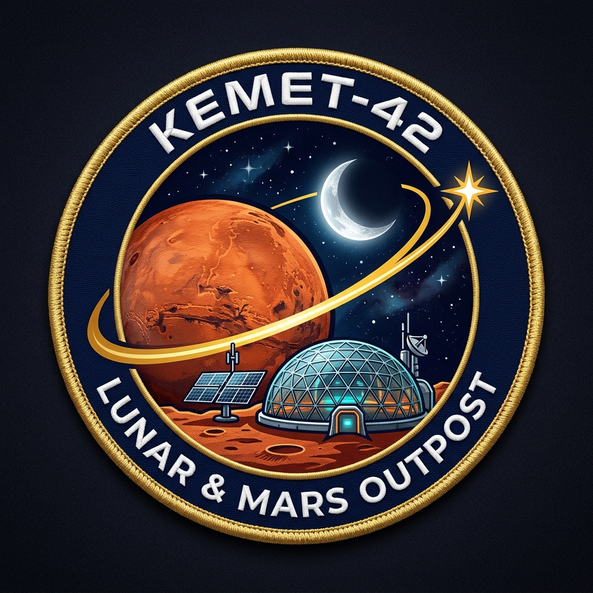

<p align="center">
  
</p>

<h1 align="center">KEMET-42</h1>

<p align="center">
  <b>Simulateur 3D interactif d'avant-poste lunaire et martien pour enfants (7–12 ans)</b><br>
  <i>Projet développé pour le <b>NASA Space Apps Challenge 2026</b></i>
</p>

<p align="center">
  
  
  
  
  
</p>

---

## 🌟 Présentation du Projet

**KEMET-42** plonge les jeunes explorateurs dans les bottes d'un commandant de mission spatiale chargé de faire survivre un avant-poste humain pendant **30 Sols** sur la **Lune** (pôle Sud / Artemis III) ou sur **Mars** (Cratère Jezero ou Gale).

Accompagnés par **NOVA**, un robot compagnon à synthèse vocale qui offre un accompagnement pédagogique bienveillant à 3 niveaux d'indices, les enfants doivent gérer 4 ressources vitales :
- **O₂ & Eau** (recyclage en boucle fermée et extraction MOXIE)
- **Bouclier Anti-Radiations** (défense contre les éruptions solaires)
- **Énergie** (panneaux solaires et gestion de l'empoussièrement)
- **Biomasse & Nourriture** (serre pressurisée inspirée de NASA Veggie)

---

## 🚀 Fonctionnalités Clés

- **Physique gravitationnelle dynamique :** Simulation authentique de la gravité de surface lunaire (1,62 m/s² ≈ 1/6 g) et martienne (3,71 m/s² ≈ 0,38 g). Les pas et sauts des astronautes flottent de façon réaliste.
- **Missions quotidiennes balisées :** Chaque Sol propose une quête claire repérée par un faisceau lumineux 3D et un radar de proximité dans le HUD.
- **Météo spatiale NASA DONKI en direct :** Interrogation en temps réel des éruptions solaires (CME) via l'API NASA DONKI. En cas de tempête géomagnétique, l'équipage doit s'abriter d'urgence dans le dôme de régolithe.
- **Assistant vocal NOVA :** Synthèse vocale naturelle (Web Speech API) avec adaptation cognitive pour les enfants de 7 à 12 ans.
- **Agriculture Spatiale Réelle :** Module de serre pressurisée basé sur les expériences NASA Veggie/APH et la trousse éducative de l'Agence spatiale canadienne (CSA).
- **Interface Pro Zéro Emoji :** Remplacement intégral des émojis par 60 icônes vectorielles SVG filaires (style NASA Mission Control).

---

## 📁 Architecture du Dépôt

```
kemet-42/
├── logo.jpg               # Insigne officiel de mission KEMET-42
├── SUBMISSION.md          # Fiche officielle de soumission Space Apps (EN)
├── server.js              # Point d'entrée serveur (API REST + Fichiers statiques)
├── package.json           # Dépendances backend et scripts
├── src/
│   ├── server.js          # Serveur Express (Auth, Scores, Missions, DONKI proxy)
│   ├── donki.js           # Module d'intégration API NASA DONKI (Live + Cache)
│   └── data/              # Données scientifiques, incidents et composants
└── frontend/
    ├── vite.config.js     # Config Vite avec runtime JSX @icons
    ├── src/
    │   ├── icons/         # Système vectoriel SVG (60 icônes sans emoji)
    │   ├── kemet/         # Moteur physique spatiale (gravité, DONKI, O₂)
    │   ├── world/         # Rendu 3D Three.js (Astronautes, Dôme, Terrain)
    │   └── ui/            # HUD télémétrique, NOVA vocal, Serre spatiale
    └── tests/             # 37 tests unitaires automatisés
```

---

## 🛠️ Installation & Démarrage Local

### Prérequis
- [Node.js](https://nodejs.org/) v20+ installé.

### 1. Démarrer le Backend (Port 3000)
```bash
npm install
npm start
```
*Le serveur démarre sur `http://localhost:3000`.*

### 2. Démarrer le Frontend 3D (Port 5173)
Dans un second terminal :
```bash
cd frontend
npm install
npm run dev
```
*Ouvrez votre navigateur sur `http://localhost:5173`.*

---

## 🧪 Tests Automatisés

Le projet comprend une suite complète de 37 tests unitaires vérifiant le moteur de jeu, la physique gravitationnelle, l'absence d'émojis et le contrat d'API :

```bash
cd frontend
node --test tests/*.test.js
```
*(Résultat : 37 passés, 0 échec)*

---

## 📚 Données & Sources Scientifiques Officielles

Toutes les données de jeu proviennent des missions et publications de la NASA et des agences partenaires :
- **NASA DONKI :** Space Weather Database Of Notifications, Knowledge, and Information ([api.nasa.gov](https://api.nasa.gov/))
- **NASA JPL Horizons :** Calculs des distances interplanétaires et délai de communication radio Terre-Lune-Mars ([ssd.jpl.nasa.gov](https://ssd.jpl.nasa.gov/horizons/))
- **NASA Planetary Fact Sheets (NSSDC) :** Constantes gravitationnelles et atmosphériques ([nssdc.gsfc.nasa.gov](https://nssdc.gsfc.nasa.gov/))
- **NASA Mars 2020 & MOXIE :** Cratère Jezero et génération d'oxygène ([mars.nasa.gov](https://mars.nasa.gov/mars2020/))
- **NASA Artemis III :** Régions candidates d'alunissage au pôle Sud lunaire ([nasa.gov](https://www.nasa.gov/))
- **NASA Veggie / APH & Agence spatiale canadienne (CSA) :** Protocoles de culture spatiale ([science.nasa.gov/veggie](https://science.nasa.gov/mission/veggie/))

---

## 🏆 Équipe & Licence

Projet développé pour le **NASA Space Apps Challenge 2026** par l'équipe **V-STEM / Smartwarrior**.
Sous licence MIT.
